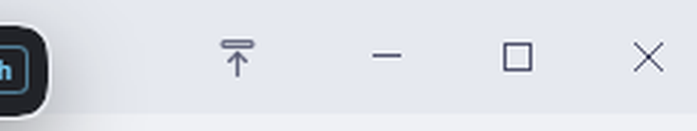
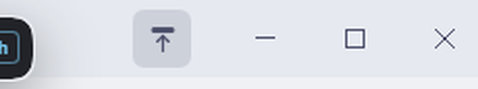

# dsh-window-pin

Harness 窗口标题栏上的**置顶按钮**：点一下让窗口始终显示在最前面，再点一下取消置顶。

| 未置顶 | 已置顶（悬停高亮） |
|---|---|
|  |  |

## 交互

- **位置**：窗口标题栏右侧、原生窗口按钮（最小化 / 最大化 / 关闭）左边；如果那片区域被别的浮层占用（例如右上角的费用徽标），按钮会整体向左让到它旁边，始终露得出来。全屏时隐藏。
- **图标**：向上箭头 + 顶部横条。横条**空心**表示未置顶，**实心 + 主题强调色**表示已置顶。
- **提示**：悬停显示 `置顶：让 Harness 窗口始终显示在最前面` / `已置顶：点击取消置顶`。
- **状态是真实状态**：每次读取都直接问窗口样式；窗口重新获得焦点时再对齐一次（Windows 会在别的程序全屏时自动摘掉置顶，按钮会跟着显示真实值）。
- 宿主不可用 / 非 Windows 桌面时按钮显示为禁用并在提示里给出原因，不会静默消失。

## 实现

- **Host half**（`host.js` + `lib/topmost.js`）
  - 注册 `GET /window-pin/state` 与 `POST /window-pin/set`（`{"pinned":true|false}`；省略 `pinned` 则取反）。
  - 用桌面外壳**随包自带**的 koffi 调 `user32.dll`，切换 Electron 主窗口（宿主进程的父进程）的 `WS_EX_TOPMOST` 扩展样式：`EnumWindows` + `GetWindowLongPtrW(GWL_EXSTYLE)` + `SetWindowPos(HWND_TOPMOST/HWND_NOTOPMOST)`。
  - 目标窗口 = 该进程下可见、`Chrome_WidgetWin_1`、面积最大的顶层窗口；写完立刻回读确认，不缓存状态。
  - 平台/FFI/窗口任一不可用都降级成 `{ ok:false, supported:false, reason }`，不抛异常、不影响宿主其它功能。
- **Client half**（`client.js`）
  - 注册进 `@deepseek-ai/dsh-client-ui-layout` 声明的 `shell.overlay` 槽（`kind: list`），叠在 Windows 自绘标题条（`--dsh-windows-titlebar-height`，40px）里。
  - 原生窗口按钮占位用 `navigator.windowControlsOverlay.getTitlebarAreaRect()` 实时测量；冲突用 `document.elementFromPoint` 逐格向左让位，并每 2 秒复查一次（邻座宽度会随会话变化）。
  - 样式全部用主题令牌（`--dsw-*`），跟随深浅色主题。
- **不修改 `app.asar` / 安装目录**：全部逻辑都在插件里，Harness 升级不会被覆盖。

## 安装（本机已装好）

与 `dshmarket`、`dsh-pc-cache-cleaner` 相同的 bundle 安装法，三步：

1. 插件目录：`C:\Users\Administrator\Desktop\Ai_project\plugins\dsh-window-pin`
2. profile 内软链接：`C:\Users\Administrator\.dsh\profiles\desktop\node_modules\dsh-window-pin` → 上面的目录
   ```powershell
   New-Item -ItemType Junction -Path "$env:USERPROFILE\.dsh\profiles\desktop\node_modules\dsh-window-pin" `
            -Target "C:\Users\Administrator\Desktop\Ai_project\plugins\dsh-window-pin"
   ```
3. profile 的 `C:\Users\Administrator\.dsh\profiles\desktop\package.json`：
   - `dependencies` 加 `"dsh-window-pin": "link:C:/Users/Administrator/Desktop/Ai_project/plugins/dsh-window-pin"`
   - `dsh.profile.bundles` 末尾加 `"dsh-window-pin"`

插件自带的 `cordis.patch.yml` 负责把它插进 Loader 树：

```yaml
- insert:
    - id: window-pin
      name: 'dsh-window-pin'
      config:
        enabled: true
```

**配置**（在 profile 的 `cordis.patch.yml` 里按 id `window-pin` 覆盖即可，`config` 整体替换）：

| 字段 | 默认 | 含义 |
|---|---|---|
| `enabled` | `true` | `false` 关闭整个插件 |
| `pid` | 宿主进程的父进程 | 目标窗口所属进程 id，只在外壳进程结构不同的时候才需要 |

**卸载**：在「设置 → 插件」里禁用或移除该 bundle，或手动从 `dsh.profile.bundles` / `dependencies` 移除并删掉软链接。

## 自检与排障

- **路由探活**：`GET http://127.0.0.1:19387/window-pin/state` 在未授权时返回 **401** = host 半已注册；**404** = 没加载。
- **离线验收**（直接对着真实窗口做置顶/取消，结束后自动恢复未置顶）：
  ```powershell
  $exe = "C:\Users\Administrator\AppData\Local\Programs\DeepSeek Harness\DeepSeek Harness.exe"
  $pid = (Get-CimInstance Win32_Process -Filter "Name like '%DeepSeek Harness%'" |
          Where-Object { $_.CommandLine -notlike '*--type=*' -and $_.CommandLine -notlike '*--expose-internals*' }).ProcessId
  $env:ELECTRON_RUN_AS_NODE = "1"
  & $exe test\topmost.test.mjs --pid $pid --mode matrix
  & $exe test\host.test.mjs    --pid $pid
  ```
- **改了 `client.js` 之后**：浏览器半需要**重载页面**才生效——本机的 client-plugin HMR 通道（`/plugins/events` SSE）一直 `ERR_FAILED`，热更新进不到页面。重载后在 DevTools 控制台看 `document.querySelector('.dwp-seat').dataset.dwpVersion` 可确认版本。
- **改了 `host.js` / `lib/topmost.js` 之后**：把 `host.js` 里 `./lib/topmost.js?gen=N` 的 `N` 递增。宿主是长期存活进程，ESM 按说明符缓存模块，不换说明符就还是旧代码。

## 限制

- 仅 **Windows 桌面版**有意义；其它平台/浏览器里按钮隐藏（`data-windows-titlebar` 不存在）或显示为禁用。
- 依赖宿主进程能解析到桌面外壳自带的 koffi（`dsh-desktop-host/node_modules/koffi`）；解析不到时降级为「不支持」。
- 置顶状态**不持久化**：重启 Harness 后回到未置顶；按钮显示的始终是窗口真实状态。
- 需要窗口属于 Electron 主进程（`process.ppid`）。若外壳进程结构特殊，可用 `pid` 配置指定。
